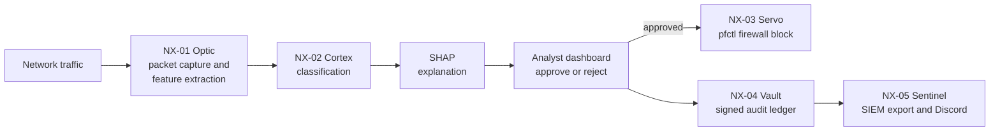

<div align="center">

# 🛡️ NovaShield

### Explainable network intrusion detection with a human in the loop

*Detect it. Explain it. Approve it. Block it. Prove it.*


[How it works](#-how-it-works) · [Detection coverage](#-detection-coverage) · [Evaluation status](#-evaluation-status) · [Quickstart](#-quickstart) · [Roadmap](#-roadmap)

</div>

---

## Why NovaShield?

Security analysts do not trust a black box that says "attack". NovaShield is built around three questions a SOC actually asks:

| Question | How NovaShield answers it |
|---|---|
| **Is this traffic malicious?** | Machine-learning classification of network flows into 14 attack classes plus benign |
| **Why does the system think so?** | SHAP explanation showing the features that pushed the decision |
| **Can I prove what happened later?** | Every decision is stored in a PostgreSQL ledger with Ed25519 signatures |

The AI recommends; **the analyst decides**. No firewall rule is applied without human approval.

> **Status:** research prototype. Results below are labelled with the evaluation method used. Please read [Evaluation status](#-evaluation-status) before relying on any number.

---

## ⚙️ How it works



| Unit | Name | What it does |
|---|---|---|
| NX-01 | **Optic** | Captures packets (Scapy) and builds flow features |
| NX-02 | **Cortex** | Hybrid detection: random forest classifier with a LightGBM + SHAP explainer |
| NX-03 | **Servo** | Applies approved blocks through macOS `pfctl` |
| NX-04 | **Vault** | PostgreSQL audit ledger with Ed25519 signatures |
| NX-05 | **Sentinel** | Alerts to Discord and SIEM export in ECS format |

**What makes it different**

- **Explainable:** every alert comes with the top contributing features.
- **Human-in-the-loop:** destructive actions need an analyst's approval.
- **Accountable:** decisions are signed and recorded.
- **Integrates:** ECS-format export fits existing SIEM pipelines.

<!-- Add a screenshot of the dashboard showing a SHAP explanation, then uncomment:

-->

---

## 🎯 Detection coverage

14 attack classes plus benign traffic, mapped to [MITRE ATT&CK](https://attack.mitre.org/):

| Family | Classes | ATT&CK technique |
|---|---|---|
| Denial of service | DDoS, DoS Hulk, DoS GoldenEye, DoS slowloris, DoS Slowhttptest | T1498 / T1499 |
| Reconnaissance | PortScan | T1046 |
| Credential attacks | FTP-Patator, SSH-Patator | T1110 |
| Web attacks | Brute Force, XSS, SQL Injection | T1190 |
| Command and control | Bot | T1071 |
| Other | Infiltration, Heartbleed | Varies |

**Data:** CIC-IDS 2017 (2,827,876 flows after cleaning, 78 flow features) plus CSE-CIC-IDS 2018 data for DDoS. Datasets are from the [Canadian Institute for Cybersecurity](https://www.unb.ca/cic/datasets/) and are not stored in this repository.

---

## 📊 Evaluation status

Honest numbers matter more than impressive ones, so every result states how it was measured.

**Current results use a random stratified 80/20 split** of pooled flows. This is the most optimistic way to evaluate an intrusion detector, because flows from the same attack run appear in both training and test data.

| Result group | Classes | Random-split result | Time / session split |
|---|---|---|---|
| Near-perfect | BENIGN, DDoS, DoS Hulk, PortScan, FTP-Patator, SSH-Patator | ≈ 100% precision and recall | In progress |
| Strong | DoS GoldenEye, Slowhttptest, slowloris | ≈ 99% | In progress |
| Weak | Bot (24% precision), Web Attack XSS (35%), Web Attack Brute Force (78%), Infiltration (67%) | Below 80% | In progress |

Overall accuracy on the random split is 99.66% with 80% benign traffic, so accuracy alone says little. Per-class precision, recall and false positive rate on held-out days are being added in `results/`.

**What is being measured next**

- Training on earlier days and testing on later days, plus cross-dataset tests
- False positive rate and expected alerts per day
- Behaviour on attack types the model has never seen (unknown-traffic handling)
- Time from flow end to alert, on stated hardware

---

## 🚀 Quickstart

> Run NovaShield only on networks you own or are authorised to monitor. Firewall blocking can disrupt legitimate traffic.

**1. Install**

```bash
git clone https://github.com/mariabatool869-star/nova_shield.git
cd nova_shield
python3 -m venv .venv && source .venv/bin/activate
pip install -r requirements.txt
```

**2. Configure.** Create a `.env` file in the project root (it must be listed in `.gitignore`; never commit it):

```bash
DATABASE_URL=postgresql://<user>:<strong-password>@localhost:5432/novashield
NOVASHIELD_PRIVATE_KEY=<your_ed25519_private_key_hex>
WEBHOOK_URL=<your_discord_webhook_url>
```

**3. Run the dashboard** (development setup; packet capture and `pfctl` need elevated privileges):

```bash
sudo python3 dashboard/app.py
```

Open <http://localhost:5000>.

---

## 🔐 Security notes

NovaShield can change firewall rules, so the tool itself must be treated as a high-value target.

- Keep secrets in `.env` or a secret manager; use a strong database password and rotate keys.
- Do not expose the dashboard to untrusted networks. Put it behind authentication and TLS.
- Load model files only from trusted sources; pickle files run code when loaded.
- Running the whole web app with `sudo` is acceptable for local development only. Splitting privileged capture and firewall control into separate minimal processes is on the roadmap.
- The audit ledger is tamper-evident, not tamper-proof: protect the signing key separately from the database.

---

## 🧠 Lessons learned

Building this surfaced problems worth sharing. Each row says what was found and where it stands.

| Finding | What happened | Status |
|---|---|---|
| **Evaluation leakage** | The first DDoS model scored 100% on a random split of a single day's capture | Identified; time- and session-based evaluation in progress |
| **Port-based routing** | DDoS was only handled when traffic used port 80 | Identified; unified pipeline in progress |
| **Closed-world behaviour** | A classifier labels attacks it has never seen as a known class, often benign | Unknown-traffic handling prototyped; validation in progress |
| **Feature mismatch** | The model expects 78 features; early live capture produced 5 | Explicit mapping added in `optic.py`; parity test against dataset captures planned |

We do not claim perfect accuracy. We claim a transparent system and an honest account of how well it works.

---

## ⚠️ Limitations

- Results so far come from lab datasets and a random split; real-world performance is unproven.
- Explanations come from a companion LightGBM model and describe that model's reasoning, not the random forest's own. Unifying them is planned.
- Live-capture feature parity with the training features has not yet been validated.
- Blocking is based on source IP and can affect shared or spoofed addresses; `pfctl` limits it to BSD and macOS.
- Rare classes (for example Infiltration, Heartbleed, SQL Injection) have very few examples, so their scores are statistically weak.

---

## 🗺️ Roadmap

**Done**
- [x] Dashboard with SHAP explanations and approve / reject workflow
- [x] PostgreSQL ledger with Ed25519 signatures
- [x] Discord alerts and ECS-format SIEM export

**Next**
- [ ] Time- and session-based evaluation with per-class precision, recall and false positive rate
- [ ] Single detection pipeline with no routing on destination port
- [ ] Explanations generated by the model that makes the decision
- [ ] Live-capture feature parity test against dataset PCAP files
- [ ] Authentication and CSRF protection on every dashboard and API action
- [ ] Block expiry, allowlist and dry-run mode in Servo; Linux `nftables` backend
- [ ] Signed, hash-verified model files
- [ ] Tests and continuous integration
- [ ] Three-minute demo video

---

## 📁 Project structure

```text
nova_shield/
├── dashboard/        # Flask web app (analyst console)
├── minions/          # NX modules: optic, cortex, servo, vault, sentinel
├── models/           # Trained models (see Security notes)
├── docs/             # Documentation
├── tests/            # Attack test suite
├── records/          # Runtime data (SIEM export)
├── requirements.txt  # Dependencies
└── README.md
```

---

## 🤝 Contributing

Issues and pull requests are welcome, especially for evaluation methodology, new datasets and hardening. Please open an issue first for larger changes.

## 📄 License

Released under the [MIT License](LICENSE).

## 🙏 Acknowledgements

[Canadian Institute for Cybersecurity](https://www.unb.ca/cic/) (CIC-IDS 2017 and CSE-CIC-IDS 2018) · [scikit-learn](https://scikit-learn.org/) · [LightGBM](https://lightgbm.readthedocs.io/) · [SHAP](https://github.com/shap/shap) · [Scapy](https://scapy.net/)

---

<div align="center">

**NovaShield** · built by [Maria Batool](https://github.com/mariabatool869-star)

</div>
