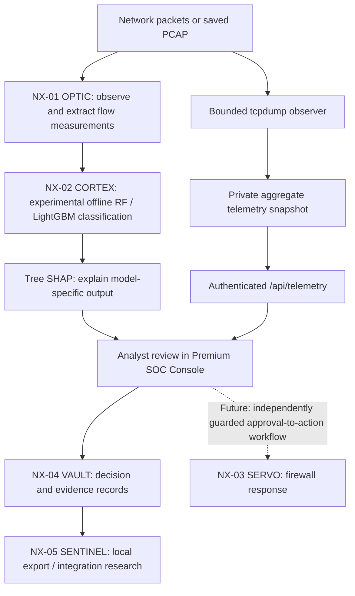

## Research Publications & Technical Reports

### Validation of Network-Flow Feature Engineering for Explainable Intrusion Detection

**Author:** Maria Batool

**Status:** Prepublication technical manuscript (2026)

[Read the technical research report (PDF)](research/reports/NovaShield_Flow_Validation_Research_Report.pdf)

This study investigates the consistency of NovaShield's network-flow
feature calculations against preserved CICFlowMeter reference outputs.

**Key result:** 468 out of 468 numerical comparisons matched across
five controlled synthetic test fixtures, within the defined
comparison tolerances.

All ten supporting PCAP and reference CSV files also passed
SHA-256 integrity verification.

The study documents initial discrepancies, engineering corrections,
and successful local revalidation.

**Research limitation:** These findings demonstrate agreement on
the tested synthetic fixtures. They do not establish real-world
intrusion-detection accuracy, production readiness, or independent
external replication.

**Related research software:**
[Zenodo DOI: 10.5281/zenodo.24056070](https://doi.org/10.5281/zenodo.24056070)

---

<div align="center">

# 🛡️ NovaShield

### Explainable Network Intrusion Detection · Human-Centred Security Operations · Reproducible Research

**Detect it. Explain it. Review it. Record it.**

[](https://www.python.org/)


**An experimental cybersecurity platform that brings network observation, interpretable machine learning, analyst oversight and evidence-oriented workflows together in one Security Operations Console.**

[The idea](#the-idea-in-plain-english) · [How it works](#how-novashield-works) · [Research](#research--engineering-contributions) · [What works today](#what-works-today) · [Run locally](#getting-started) · [Limitations](#limitations-and-research-integrity) · [Roadmap](#roadmap)

</div>

---

> [!IMPORTANT]
> **Current status — research prototype, not a production intrusion-prevention system.** NovaShield has demonstrated real, *bounded* network observation, a private telemetry snapshot, and an authenticated browser display. Its Random Forest / LightGBM / SHAP workflows are experimental **offline** research capabilities. Continuous live detection, production accuracy, automated blocking from the dashboard, and end-to-end SIEM delivery are **not** validated or enabled. Numbers from feature-parity testing must not be interpreted as intrusion-detection accuracy.

## The idea in plain English

Imagine a security analyst watching the entrance to a building. A basic alarm says **“Something suspicious happened.”** A better system helps answer **what happened, what evidence supports the warning, how confident the analysis is, and whether a person should act**.

NovaShield explores that second approach for computer networks.

Networks send small pieces of information called **packets**. Related packets can be summarised into **flows**: conversations between computers. Those conversations have measurable characteristics—how long they lasted, how many packets were exchanged, packet sizes and timing patterns. A machine-learning model can study those measurements and estimate which known traffic category resembles a flow. An explanation method can then show which measurements contributed to the model's result.

But a prediction is **not proof of an attack**. NovaShield is being designed around a human analyst who can inspect evidence before a potentially disruptive response is considered. The project also studies how to preserve an auditable record of what an analyst decided.

**The goal is not to replace security analysts. It is to make security analysis more understandable, measurable and accountable.**

## Why I built NovaShield

Many intrusion-detection demonstrations stop at a high accuracy score on a public dataset. Real security operations ask harder questions:

- **Can we trust the input?** Do our measured features match the definitions used to train the model?
- **Does the model generalise?** Can it recognise traffic from a different day, environment or attack campaign?
- **Can we explain the result?** Are the explanations for the model that actually made the prediction?
- **Can an analyst challenge a warning?** Is the system designed for human review rather than automatic disruption?
- **Can we reconstruct what happened?** Are actions recorded with useful, verifiable evidence?
- **Can an interface distinguish reality from simulation?** Does “live” truly mean live, or merely the last completed capture?

NovaShield is my practical investigation of these questions, spanning network measurement, machine learning, explainability, secure application development and security-operations design.

## How NovaShield works

NovaShield consists of **five cooperating research modules**. The following diagram represents the **intended SOC architecture**, not a claim that every connection is running continuously today.



### The five modules

| Module | Responsibility | Current implementation boundary |
|---|---|---|
| **NX-01 OPTIC** | Network observations, traffic features and rule-oriented alert experiments | Real bounded packet observation is working; saved-PCAP feature workflows exist. No always-on detection service has been established. |
| **NX-02 CORTEX** | Traffic classification and interpretable AI research | Offline Random Forest, LightGBM and class-specific Tree SHAP research paths exist; not connected to continuous live traffic. |
| **NX-03 SERVO** | Controlled network response | A macOS `pfctl` response component exists, but the dashboard intentionally does **not** execute firewall blocks. Production safeguards remain incomplete. |
| **NX-04 VAULT** | Evidence and decision provenance | PostgreSQL-based research ledger with cryptographic integrity mechanisms; key-management, concurrency and anchoring hardening remain open. |
| **NX-05 SENTINEL** | Export and external SOC integration | Local NDJSON / SIEM-export research exists; webhook delivery is not a verified live integration. |

### What a complete investigation would look like

1. **Observe:** Inspect authorised traffic or load a saved packet capture (PCAP).
2. **Measure:** Convert traffic into consistently defined numerical flow features.
3. **Assess:** Run a trained model in an explicitly supported workflow.
4. **Explain:** Show which features contributed to that model's output; an explanation is **not** proof of causation.
5. **Review:** Let an analyst examine the context, uncertainty and evidence.
6. **Record:** Preserve the decision in an auditable form.
7. **Respond, only when safe:** Any future firewall response must be explicitly authorised, tested and separated from the web application.

**Important:** Steps 1–6 currently exist across different research and prototype workflows; they are **not yet one validated automated live-detection pipeline**. Step 7 is not triggered by today's dashboard.

## The Premium SOC Console

The browser console brings multiple research and operational concepts into one place:

- **Command Centre:** capability states that distinguish offline research from real-time operations.
- **Real Network Observation:** packet counts from a completed, operator-initiated capture, the interface used, timestamp, provenance and capture-inactive status.
- **Network Flow Analysis:** an allowlisted synthetic PCAP and measured flow-feature inspection.
- **Model Research & Explainability:** offline experiments using the Phase 6 model adapter.
- **Threat Feed & Investigation:** alert/case-review user-interface workflows, separate from real network observation.
- **Evidence & Audit:** a dashboard view for decisions and verification workflows.
- **Administrator access:** authenticated endpoints, session controls and CSRF protection for relevant state-changing actions.

The Console is a **research interface**. A status card must not imply that network monitoring, AI inference or blocking is active when it is not.

<!-- Optional: add a real, reviewed screenshot to docs/images/console.png, then uncomment:

-->

## Research & engineering contributions

### 1. Feature fidelity before model performance

A model trained on 78 named, ordered network-flow measurements is only meaningful when the feature extractor produces the **same quantities using the same definitions**. Differences in flow termination, duration units or rate calculations can change a prediction even when the algorithm itself is unchanged.

To investigate this, I developed a flow-assembly and feature-export validation workflow and compared exported numerical features against **CICFlowMeter reference output** on controlled synthetic fixtures.

**Verified local research milestone (8 November 2026):**

| Verification | Recorded result |
|---|---|
| Reference-comparison fixtures | **5 passing fixtures** (tests 4, 5, 7, 8 and 9) |
| Numerical comparisons | **468 / 468 matched within the comparator's tolerance** |
| Key edge case | Active single-packet flows are not exported by the reference at end of file |
| Precision issue addressed | Flow-duration precision when computing rate-based features |
| Interpretation | Agreement **on the tested fixtures only** |

This is a **feature-comparison result**, **not 100% attack-detection accuracy**, not proof of full CICFlowMeter equivalence, and not proof of generalisation across datasets or live networks. It is valuable because it tests the measurement foundation on which model predictions depend.

Relevant research components include:

- `scripts/novashield_flow_assembler.py`
- `scripts/novashield_feature_exporter.py`
- `research_fixtures/automated_validation/run_tests.py`

### 2. Random Forest and LightGBM experimentation

NovaShield's Phase 6 research contains separate **Random Forest** and **LightGBM** classifiers and an adapter that loads stored model artifacts for offline analysis. The adapter checks the **78-feature input contract**, preserves feature ordering and obtains predictions and class probabilities from the corresponding model.

Recorded Phase 6 experiment metadata describes **168,592 training rows** and **42,148 test rows**. These figures describe that experiment's dataset split; they do not establish independent-day evaluation or live performance. Public CIC-IDS2017 / CSE-CIC-IDS2018 data also appear in the project's earlier data-preparation research; avoid conflating the larger source datasets with this narrower Phase 6 experiment.

The historical README reports **99.66% overall accuracy** on a **random stratified split** in earlier model work. That figure is **historical and method-dependent**, not a current production benchmark. Random splits can put highly related traffic from the same collection sessions in training and testing, potentially exaggerating generalisation. A predominantly benign dataset can also make overall accuracy hide weak attack-class performance.

Earlier reported weaknesses included Bot, web-attack and infiltration categories; rare classes need much stronger support before reliable conclusions can be drawn. **No verified cross-day, cross-environment performance or calibrated live alert rate is claimed here.**

### 3. Explaining the prediction, not decorating it

SHAP (SHapley Additive exPlanations) assigns feature contributions to a particular model output. For tree ensembles, **Tree SHAP** can provide model-specific local explanations.

The Phase 6 adapter computes class-specific SHAP results for the model being analysed. This is more rigorous than attaching a convenient explanation from an unrelated companion model. Earlier prototype architecture sometimes used a LightGBM explainer alongside a separate Random Forest decision; those explanations should **not** be presented as explanations of the Random Forest prediction.

**Research rule:** explanations are conditional on the trained model, chosen output and reference assumptions. They do not demonstrate that an alert is correct, that a feature caused an attack, or that a decision is safe to enforce.

### 4. Measuring *real* packets without pretending to run a live IDS

A separate bounded observer uses macOS `tcpdump` to inspect an explicitly selected network interface. A nonprivileged telemetry collector parses the observer transcript, validates completion status and writes a small aggregate JSON snapshot.

The validated observation workflow includes:

- Explicit time and packet limits on the capture session.
- Separation of privileges: packet capture requires elevated permission, while the collector and Flask dashboard do not.
- Private snapshot storage under `records/telemetry/` with restrictive local permissions.
- Packet and TCP/UDP/IPv4/IPv6 counters rather than raw packet addresses in the snapshot.
- Snapshot metadata such as interface, observation timestamp, completion status, provenance and `capture_active: false`.
- Administrator-protected `GET /api/telemetry` and a browser panel that clears its values after logout.

**Observed end-to-end result (8 November 2026):** **12 packet lines** on `en0`; the text parser categorised **12 as TCP, 0 as UDP, 0 as other**. The snapshot passed **10 local integrity/schema/permissions checks**, the API returned **403 without authentication** and **200 in an isolated test with a mocked valid administrator session**, and the browser displayed the observation and cleared it on logout.

These counts are an **individual bounded observation**, not a measurement of overall network security. `operator_observed` is an operator-supplied provenance label, not cryptographic attestation. Text parsing depends on the observer's output format; the actual capture was not independently packet-by-packet verified. The dashboard does **not** run a continuous packet-capture service.

### 5. Human oversight, audit integrity and safe system boundaries

The broader prototype investigates how to make a detection **reviewable** and a decision **traceable**. Its Flask application includes administrator/session and CSRF controls. An analyst's decision can be recorded without automatically sending a privileged firewall command.

The VAULT work explores PostgreSQL records, HMAC linkage and Ed25519 signatures. This is **tamper-evidence research**, not a claim that database contents are immutable against every adversary. Signing-key protection, hardcoded-key elimination, concurrency behaviour and independent anchoring still need further hardening.

The SERVO response component is intentionally kept outside the dashboard's active decision path. Unreviewed IP blocking can affect legitimate users, shared addresses and critical services; building a button is not sufficient to make enforcement safe.

## What works today

| Capability | Status | Evidence / qualification |
|---|---|---|
| Premium SOC Console prototype | **Implemented** | Flask templates and shared browser JavaScript; ongoing visual refinement |
| Administrator session protection | **Implemented / tested locally** | 403 unauthorised telemetry request; authenticated retrieval path tested; browser sign-in/out observed |
| Bounded real-network observation | **Demonstrated** | Local operator-initiated `tcpdump` observer, finite packet/time limits |
| Private aggregate telemetry snapshot | **Demonstrated** | JSON permissions, schema and count checks passed |
| Browser telemetry + logout clearing | **Demonstrated** | 12-packet saved observation displayed; sensitive counts hidden on logout |
| Saved-PCAP feature inspection | **Research workflow** | Separate allowlisted offline endpoint |
| CICFlowMeter feature comparisons | **5 fixtures passed** | 468/468 numerical comparisons within stated comparator tolerance |
| Random Forest / LightGBM / SHAP | **Experimental offline models** | Input contract and offline adapter, without production validation |
| Analyst case and decision workflows | **Prototype** | Dashboard/registry and VAULT research components; not a full production SOC |
| Continuous network monitoring | **Not implemented** | No persistent observer service or reliable live-health indicator |
| Validated live AI alerts | **Not implemented** | Models not wired into a tested live pipeline |
| Automatic firewall enforcement from UI | **Disabled** | Dashboard does not invoke `pfctl` blocking |
| Verified external SIEM / webhook delivery | **Not established** | Local export and integration stubs require end-to-end verification |

## Detection categories under study

The historical modelling work uses traffic categories associated with the **CIC-IDS2017** dataset and related experiments, including benign traffic and examples of:

| Family | Examples from the research dataset |
|---|---|
| Denial of service | DDoS, DoS Hulk, GoldenEye, slowloris, Slowhttptest |
| Reconnaissance | PortScan |
| Credential attacks | FTP-Patator, SSH-Patator |
| Web attacks | Brute Force, XSS, SQL Injection |
| Bot / infiltration | Bot, Infiltration |
| Other rare attacks | Heartbleed |

**Dataset category coverage is not validated real-world detection coverage.** Some classes have too few representative examples for reliable estimates. Novel attacks, encrypted traffic, differences in protocols and environmental drift remain open challenges.

## Getting started

> [!CAUTION]
> Use NovaShield only on systems and networks you own or have explicit permission to test. **Do not run the Flask dashboard with `sudo`.** Running `sudo` on the entire web application is unnecessary and expands the consequences of a web-app vulnerability. Packet capture, when needed, is handled separately.

### Prerequisites

- macOS for the current observer and `pfctl` response research components.
- A Python environment with the versions and packages required by this checkout (`requirements.txt`); Python/model binary compatibility should be verified locally.
- A **local** browser; PostgreSQL and additional dependencies are needed for the corresponding workflows.
- A locally configured `.env` containing a strong `FLASK_SECRET_KEY` (**at least 32 characters**). Keep secrets outside Git.

### Install for local research

```bash
git clone https://github.com/mariabatool869-star/nova_shield.git
cd nova_shield
python3 -m venv .venv
source .venv/bin/activate
python -m pip install -r requirements.txt
```

Create a `.env` in the project root, following your local configuration requirements. The minimum application secret is:

```dotenv
FLASK_SECRET_KEY=replace-with-a-unique-secret-of-at-least-32-characters
```

Do not commit `.env`, database credentials, signing keys, packet captures, personal traffic logs or untrusted model artifacts. Other environment variables depend on the configured modules and are not claimed to be exhaustively documented here.

### Run the local dashboard in safe research mode

```bash
NOVASHIELD_OFFLINE_ONLY=1 python3 dashboard/app.py
```

Open:

- Main dashboard: `http://127.0.0.1:5000/`
- Premium SOC Console: `http://127.0.0.1:5000/console-preview`

Sign in using an administrator account configured in your local deployment. The exact credential setup depends on your environment and should not be published in the README.

**Offline-only mode** is deliberately restrictive: it allows eligible saved research workflows and completed-observation display, but does **not** mean live capture or firewall enforcement is enabled.

### Optional: bounded network observation (advanced, macOS)

The observer uses privileged packet access and the collector remains unprivileged. An example of the locally tested pattern is:

```bash
set -o pipefail
sudo python3 scripts/novashield_live_observer.py --interface en0 --seconds 10 --max-packets 20 \
  | python3 scripts/novashield_telemetry_collector.py --provenance operator_observed
```

Replace `en0` with an interface you have independently verified and are authorised to monitor. On macOS, use a shell that supports `pipefail` (for example zsh). **This is a short observation session, not a background monitoring daemon.** Do not run the collector or Flask dashboard as root; do not expose raw capture output publicly.

## Repository guide

```text
nova_shield/
├── dashboard/
│   ├── app.py                         # Flask routes, auth and SOC API
│   ├── templates/                      # Main and Premium Console HTML
│   └── static/                         # CSS, JavaScript and shield.gif
├── minions/                            # OPTIC / CORTEX / SERVO / VAULT / SIEM components
├── phase6_xai/                         # Offline model adapter, research and artifacts
├── phase7_soc/                         # Analyst case registry research
├── scripts/
│   ├── novashield_live_observer.py     # Bounded packet observation
│   ├── novashield_telemetry_collector.py
│   ├── novashield_flow_assembler.py
│   └── novashield_feature_exporter.py
├── research_fixtures/
│   └── automated_validation/          # CICFlowMeter comparison runner
├── records/
│   └── telemetry/                     # Private local runtime snapshots
├── requirements.txt
└── README.md
```

Some directories contain local research assets, datasets or model artifacts that may not be included in every published checkout. The tree describes the researched project structure rather than guaranteeing that every file is shipped.

## Limitations and research integrity

**NovaShield is not yet suitable for protecting a real organisation without independent validation and hardening.** Current limitations include:

1. **Distribution shift:** Public benchmark scores do not establish performance on current, unseen organisational traffic.
2. **Evaluation methodology:** The earlier 99.66% figure came from a random split and cannot be compared to a time-separated or cross-network benchmark.
3. **Class imbalance:** Rare attacks make some per-class scores statistically unstable.
4. **Feature contract:** Five passing synthetic fixtures do not prove global equivalence to CICFlowMeter or live feature parity.
5. **Explanation fidelity:** A SHAP explanation refers to the model and output actually explained; it is not a causal security conclusion.
6. **Operational state:** The real network observer is manually invoked and bounded; the Console must not label it continuous monitoring.
7. **Alert quality:** False positives per day, precision under realistic base rates, calibration and analyst burden have not been established.
8. **Response safety:** Firewall blocking is not enabled from the Console and requires explicit safeguards, allowlists, time limits, rollback and audit trails.
9. **Evidence security:** Local file permissions and cryptographic chaining do not replace independent key management, anchoring or full threat-model review.
10. **Deployment:** The local Flask development server is not a production architecture. Production deployment requires additional security engineering, monitoring, TLS and operational controls.

## Roadmap

**Completed or demonstrated research milestones**

- [x] Five-module security architecture and SOC workflow prototype.
- [x] Offline Random Forest / LightGBM model experimentation and model-specific Tree SHAP path.
- [x] CICFlowMeter-reference comparisons on five synthetic fixtures: **468/468 numerical matches within comparator tolerance**.
- [x] Time- and packet-bounded macOS network observer.
- [x] Unprivileged telemetry collector and private aggregate snapshot.
- [x] Administrator-protected read-only telemetry API.
- [x] Browser observation display and logout clearing.
- [x] Premium Console design and integration work.

**Highest-priority research and engineering work**

- [ ] Publish reproducible, independently run feature-comparison fixtures and comparator tolerances.
- [ ] Perform temporal, session-separated and cross-dataset AI evaluation with per-class precision/recall and confidence intervals.
- [ ] Report calibration, false positives per day, expected analyst workload and unknown-traffic behaviour.
- [ ] Validate real PCAP-to-78-feature parity over diverse protocols and capture conditions.
- [ ] Design a persistent monitoring worker with explicit Start/Stop, health reporting, bounded resources and safe privilege separation.
- [ ] Integrate the live feature pipeline with model inference only after validation, using truthful operational-status indicators.
- [ ] Harden database integrity, signing-key storage, concurrency and independent audit anchoring.
- [ ] Implement a separately privileged, reversible, allowlisted and fully authorised response workflow, with fail-safe defaults.
- [ ] Verify ECS/schema consistency and actual SIEM/webhook delivery end to end.
- [ ] Add automated regression tests, CI, deployment documentation, demo video and representative screenshots.

## Research questions and collaboration

NovaShield is especially relevant to researchers, security engineers and SOC practitioners interested in:

- **Data fidelity:** How can feature-extraction implementations be tested against a reference?
- **Generalisation:** What survives when we stop randomly mixing related flows between train and test?
- **Trustworthy explanations:** How do we connect feature attributions to the exact model making the prediction?
- **Human oversight:** What evidence should an analyst see before approving a disruptive action?
- **Security of security tooling:** How can capture privileges, model loading, session protection and audit records themselves be defended?

Constructive feedback, issue reports and reproducibility contributions are welcome. Particularly valuable contributions include additional reference fixtures, independent evaluation protocols, negative tests, attack-class error analysis, and secure system-design reviews. Please open an issue before undertaking major changes.

## Scientific and technical references

- **Canadian Institute for Cybersecurity (CIC)** — [Datasets and CIC-IDS2017](https://www.unb.ca/cic/datasets/); original research traffic context and limitations.
- **CICFlowMeter** — [Reference project](https://github.com/ahlashkari/CICFlowMeter); network-flow feature generation and comparison context.
- **SHAP documentation** — [TreeExplainer](https://shap.readthedocs.io/en/stable/generated/shap.TreeExplainer.html); model-specific local explanations and assumptions.
- **scikit-learn** — [Model evaluation guidance](https://scikit-learn.org/stable/modules/cross_validation.html); validation and leakage considerations.
- **LightGBM** — [Official documentation](https://lightgbm.readthedocs.io/); gradient-boosted tree models.
- **MITRE ATT&CK** — [ATT&CK knowledge base](https://attack.mitre.org/); optional context for mapping behaviours, **not** an assertion that benchmark labels directly establish technique detection.
- **NIST AI Risk Management Framework** — [AI RMF](https://www.nist.gov/itl/ai-risk-management-framework); validity, accountability and governance context.

## Attribution and licensing

NovaShield is developed by **Maria Batool** · [GitHub profile](https://github.com/mariabatool869-star).

The project draws on publicly documented research and tools from the Canadian Institute for Cybersecurity, scikit-learn, LightGBM, SHAP, Scapy, Flask and the Python open-source ecosystem. This attribution does not imply their endorsement.

**Licence:** Check the repository's `LICENSE` file for the governing terms before reuse. The earlier README listed MIT; this README does not independently verify the presence or exact contents of that licence file.

---

<div align="center">

**NovaShield — making intrusion-detection research more explainable, testable and accountable.**

*Research prototype · Designed for learning, verification and responsible cybersecurity experimentation*

</div>
